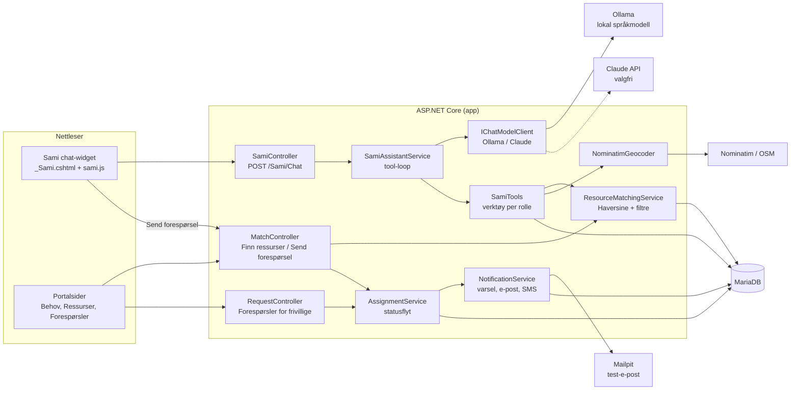
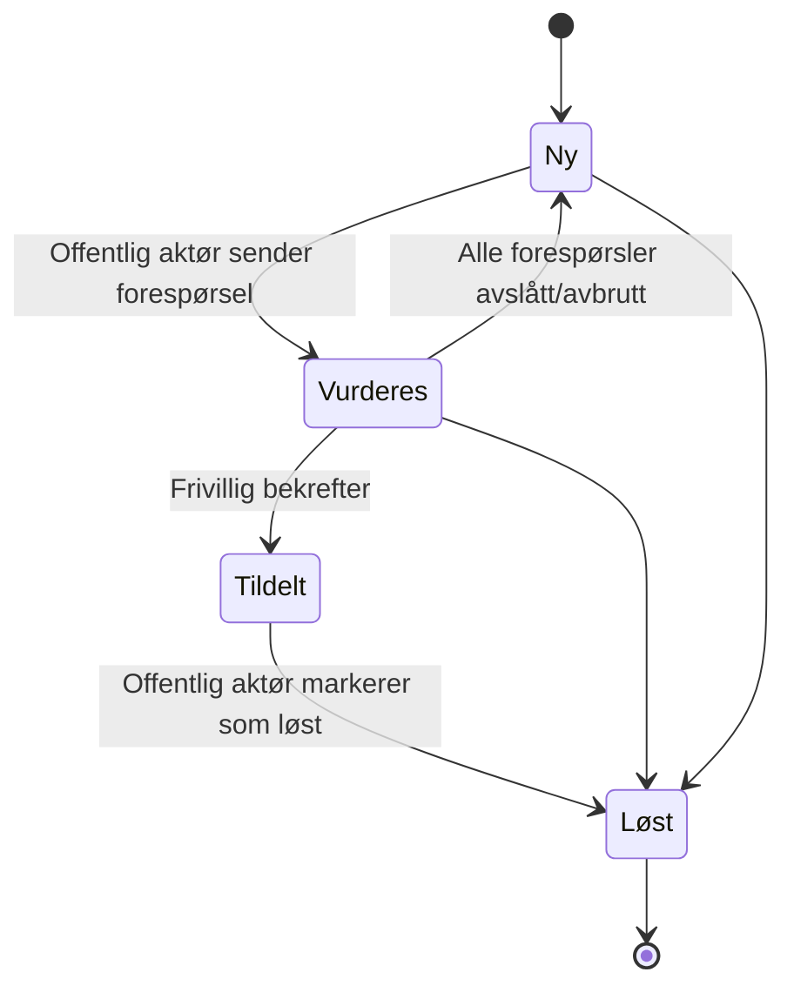

# Sami og matching – arkitektur

Dette dokumentet beskriver hvordan AI-assistenten Sami og matchingen mellom behov og ressurser er bygget.
Diagrammet kan limes inn i https://mermaid.live for å lage et bilde til rapporten.

## Komponentdiagram

## Statusflyt for et behov

## Viktige designvalg

- **Deterministisk matching.** Avstand (Haversine) og filtrering på type og status gjøres i C#.
  Språkmodellen får ferdige kandidater og forklarer og rangerer dem. Den kan ikke finne på ressurser.
- **Menneske i løkken.** Sami kan bare *foreslå* en match (`suggest_match`). Forespørselen sendes først når
  den offentlige aktøren trykker «Send forespørsel», og tildelingen gjelder først når den frivillige bekrefter.
- **Personvern.** Verktøyene sender aldri e-post eller telefonnummer til modellen. Frivillige ser bare
  omtrentlig avstand til behov, ikke eksakt sted eller hvem som har meldt behovet.
- **Rollebaserte verktøy.** Hver rolle får sitt eget sett med verktøy, og hvert verktøy sjekker rollen
  på nytt (forsvar i dybden). Rollen hentes fra Identity på serveren, aldri fra nettleseren.
- **Utskiftbar modell.** `IChatModelClient` har én implementasjon for Ollama (lokal, gratis) og én for
  Claude API. Valget gjøres i konfigurasjonen.
- **Sporbarhet.** Alle verktøykall logges, og forespørsler fra Sami-forslag merkes (`SuggestedByAssistant`).
